# NT547 - LAB 06 - BÁO CÁO (TỰ ĐIỀN)

**MSSV:** 24521896  | **Họ tên:** Nguyễn Quốc Trường | **Lớp:** NT547.R11.ANTT.1
**Session code tự sinh:** SC-610E8F | **Tên contract:** StakingPool_1896
**Solidity / Slither:** 0.8.24 / 0.11.6 | **Ngày hoàn thành:** 20/11/2026
**URL GitHub repository:** https://github.com/Master-Pillow/Lab6-Blockchain

> **Môi trường:** Windows 11 + WSL2 Kali GNU/Linux Rolling; Python 3.12.16 trong `.venv` (tạo bằng uv); `slither-analyzer` 0.11.6; solc 0.8.24 (solc-select); Git; Graphviz `dot`.
> `AuditTarget.sol` (90 dòng) được sinh bằng `tools/create_lab.py` từ MSSV, thời điểm sinh 2026-11-20T03:11:20Z (UTC). SHA-256 của tệp trước lần quét đầu trùng `baseline_sha256` = `8923540f355e2d284588c3dde2b7546a2596c6bbd725da0cd8983c80f32e09e4`.
> Ảnh minh chứng nằm trong `evidence/screenshots/`, tên tệp `hNN_...png` đánh số trùng với số hình trong báo cáo `BAO_CAO_LAB06_24521896.pdf` nộp kèm.

## 1. Static scan (2,0 điểm)

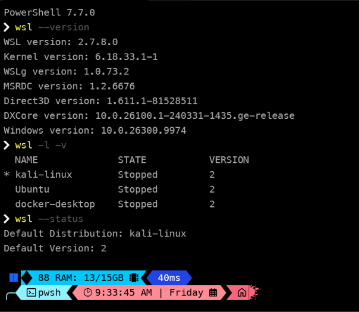
*Hình 1: PowerShell Windows xác nhận distro kali-linux đang chạy WSL phiên bản 2 (wsl --version, wsl -l -v, wsl --status), đúng môi trường thực hành đã chọn.*

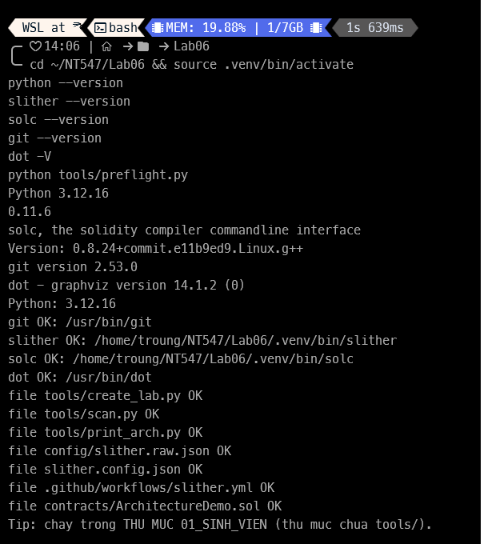
*Hình 2: Terminal Kali trong ~/NT547/Lab06 với .venv Python 3.12.16: Slither 0.11.6, solc 0.8.24, git và Graphviz dot sẵn sàng; preflight xác nhận đủ file của bộ lab.*

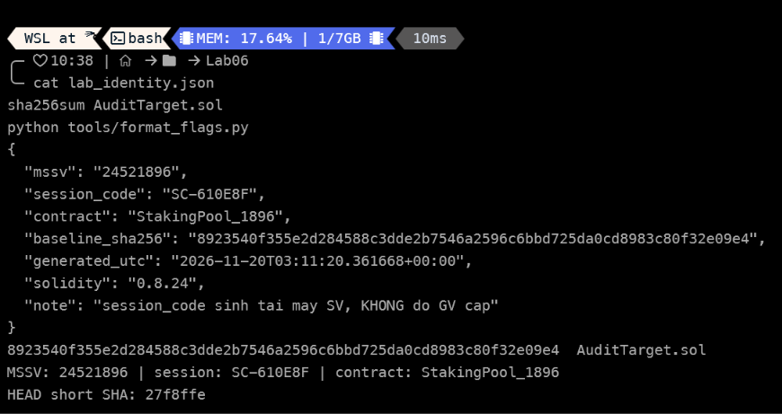
*Hình 3: Định danh bài lab: lab_identity.json ghi MSSV 24521896, Session Code SC-610E8F, contract StakingPool_1896; SHA-256 của AuditTarget.sol trùng baseline_sha256.*

- Lệnh raw: `python tools/scan.py --mode raw --tag before` (tương đương `slither AuditTarget.sol --config-file config/slither.raw.json --fail-none --json evidence/before_raw/slither.json`; Hình 4)
- Số lượng finding raw từ `evidence/before_raw/summary.json`:
  - High: 4; Medium: 2; Low: 0; Informational: 4; Optimization: 0 (tổng 10, Slither chạy 102 detector)
- Chạy configured: `python tools/scan.py --mode configured --tag before` (dùng `slither.config.json`): High 4; Medium 2; Low 0; Informational 0; Optimization 0 (tổng 6, chỉ còn 64 detector; Hình 5). Mỗi thư mục `before_raw/`, `before_configured/` có đủ 4 tệp: `slither.json`, `findings.csv`, `summary.json`, `command_and_output.txt`.
- So sánh raw/configured: `slither.config.json` gồm `exclude_low`, `exclude_informational` và loại detector `solc-version`. Cấu hình chỉ ẩn 4 cảnh báo Informational (3 `low-level-calls` và 1 `naming-convention`). Số High và Medium giữ nguyên 4 và 2, tức **không có High/Medium nào biến mất khi chỉ đổi cấu hình**: tệp cấu hình là bộ lọc hiển thị, không làm thay đổi rủi ro của mã. Optimization không bị loại nhưng hợp đồng không phát sinh cảnh báo nào thuộc nhóm này. Cờ `--fail-none` làm `process_exit_code` luôn bằng 0, nên mã thoát 0 ở bước này không có nghĩa hợp đồng an toàn.
- 3 detector **khác tên**: `tx-origin`, `unchecked-transfer`, `encode-packed-collision`. Thực tế `before_raw` có 6 detector khác tên ở mức High/Medium (thêm `weak-prng`, `reentrancy-eth`, `unchecked-lowlevel`), nhiều hơn yêu cầu tối thiểu.

Danh sách đầy đủ 10 finding đọc từ `evidence/before_raw/findings.csv` (Hình 6), mã nguồn dòng 42–89 ở Hình 7:

| # | Detector | Impact | Confidence | Vị trí (AuditTarget.sol) |
|---|---|---|---|---|
| 1 | `weak-prng` | High | Medium | `weekdayIndex()` 80–82, dòng 81 |
| 2 | `encode-packed-collision` | High | High | `useCode(string,string)` 84–89, dòng 85 |
| 3 | `reentrancy-eth` | High | Medium | `claimSafe()` 73–78; call dòng 75, ghi state dòng 77 |
| 4 | `unchecked-transfer` | High | Medium | `withdrawToken(uint256)` 57–61, dòng 60 |
| 5 | `tx-origin` | Medium | Medium | `setAdmin(address)` 63–67, dòng 64 |
| 6 | `unchecked-lowlevel` | Medium | Medium | `sweep(address)` 47–50, dòng 49 |
| 7–9 | `low-level-calls` (×3) | Informational | High | `sweep` dòng 49; `claimSafe` dòng 75; `ownerWithdraw` dòng 43 |
| 10 | `naming-convention` | Informational | High | Tên `StakingPool_1896` không theo CapWords (10–90) |

| ID finding | Detector | Impact | Confidence | Source (file:dòng) | Luồng dữ liệu: đầu vào -> thao tác -> tác hại |
|---|---|---|---|---|---|
| F01 | `tx-origin` | Medium | Medium | AuditTarget.sol:64 – `setAdmin(address)` | Đầu vào là `tx.origin` (EOA ký giao dịch) và tham số `newOwner` do người gọi trực tiếp truyền vào -> điều kiện `tx.origin == owner` vẫn đúng khi owner bị dụ gọi một contract trung gian độc hại, bất kể `msg.sender` là ai -> thực thi `owner = newOwner` -> kẻ tấn công chiếm quyền quản trị rồi rút toàn bộ ETH qua `sweep`/`ownerWithdraw`. |
| F02 | `unchecked-transfer` | High | Medium | AuditTarget.sol:60 – `withdrawToken(uint256)` | Đầu vào `amount` từ người dùng -> `tokenCredit[msg.sender]` bị trừ trước -> gọi `rewardToken.transfer(msg.sender, amount)` nhưng bỏ qua giá trị `bool` trả về -> nếu token trả `false` thay vì revert, giao dịch vẫn thành công: người dùng mất credit mà không nhận token, sổ sách lệch với số dư thực. |
| F03 | `encode-packed-collision` | High | High | AuditTarget.sol:85 – `useCode(string,string)` | Đầu vào là hai chuỗi động `campaign`, `code` -> `keccak256(abi.encodePacked(campaign, code))` nối byte mà không mã hóa độ dài, nên `("ab","c")` và `("a","bc")` cho cùng preimage `"abc"`, cùng `id` -> kẻ tấn công đánh dấu trước `claimedKeys[id]` của người khác (front-running/griefing), khiến mã hợp lệ bị từ chối với lỗi `"used"`. |

Ghi chú: `Confidence` là độ tin cậy của luật phát hiện (khả năng cảnh báo đúng về mặt mẫu mã), không phải xác suất bị khai thác. `Impact` là mức hậu quả chuẩn hóa do công cụ gán khi mẫu lỗi bị khai thác, không phải rủi ro thực tế trong ngữ cảnh cụ thể. Rủi ro thực tế chỉ xác định được sau bước triage ở mục 2.

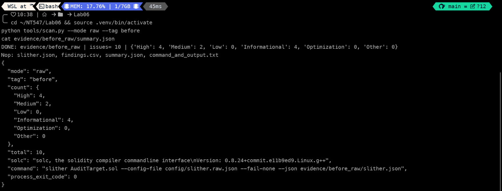
*Hình 4: Quét BEFORE chế độ raw (config/slither.raw.json, --fail-none): 10 finding gồm High 4, Medium 2, Low 0, Informational 4, Optimization 0; mã thoát 0 chỉ do --fail-none.*

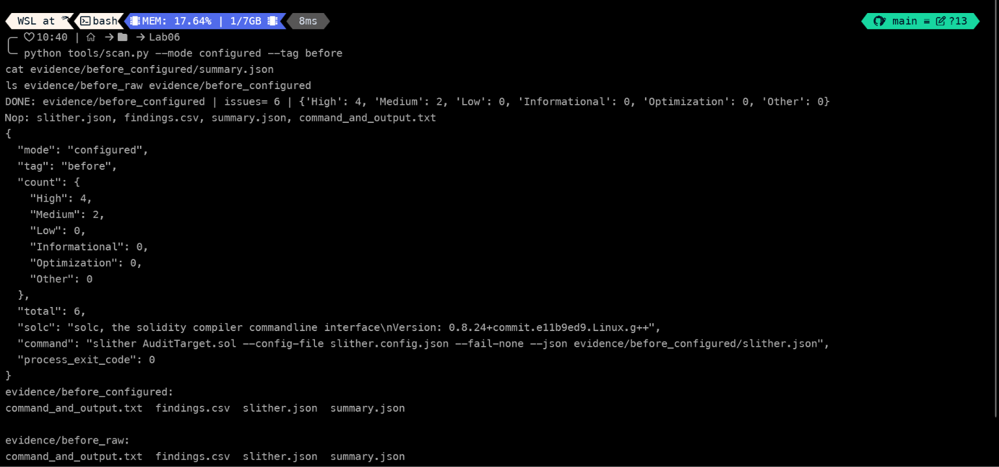
*Hình 5: Quét BEFORE chế độ configured (slither.config.json): 6 finding, High/Medium giữ nguyên 4/2, chỉ nhóm Informational bị ẩn; mỗi thư mục có đủ 4 tệp bằng chứng.*

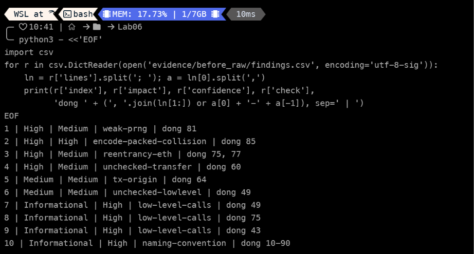
*Hình 6: Danh sách 10 finding đọc từ evidence/before_raw/findings.csv với detector, impact, confidence và dòng mã.*

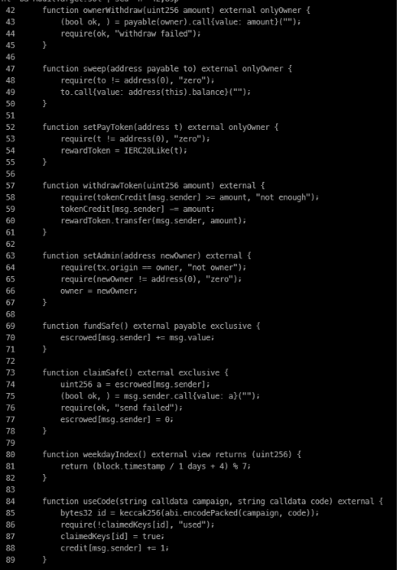
*Hình 7: Mã nguồn AuditTarget.sol (dòng 42–89) tại các vị trí detector trỏ tới, dùng để lập luận luồng dữ liệu.*

## 2. Triage và sửa lỗi (2,5 điểm)

Đọc toàn bộ AuditTarget.sol: nhận diện **4 mẫu lỗi thật + 2 đoạn cần đánh giá ngữ cảnh**,
kể cả khi Slither không hiển thị đủ 6 cảnh báo. Với mẫu không có detector,
ghi “Manual review / Not reported”, KHÔNG sửa slither.json hoặc tạo finding giả.

Mỗi finding High/Medium được đánh giá qua bốn câu hỏi: (i) ai gọi được và cần điều kiện gì; (ii) state/tài sản nào bị tác động; (iii) trong ngữ cảnh hiện tại có khai thác được không; (iv) phân loại TP / FP theo ngữ cảnh / Chưa kết luận, kèm Fix hoặc Accept có lý do. Cả sáu đoạn đều được Slither báo, nên không có mục nào phải ghi “Manual review / Not reported”.

| Detector + vị trí | TP / FP / Chưa kết luận | Bằng chứng kiểm soát/khả năng khai thác | Biện pháp (Fix / Accept có lý do) | Sau sửa |
|---|---|---|---|---|
| `tx-origin` – `setAdmin`, AuditTarget.sol:64 | **TP** | Hàm `external` không có modifier, không kiểm tra `msg.sender`. Mọi contract trung gian được owner gọi đều vượt qua điều kiện. Biến bị ghi là `owner`, tức toàn quyền quản trị. | **Fix:** `require(msg.sender == owner, "not owner");` (giữ kiểm tra địa chỉ 0) | Không còn |
| `unchecked-lowlevel` – `sweep`, AuditTarget.sol:49 | **TP** (rủi ro thấp–trung bình) | Chỉ owner gọi được. Nếu người nhận từ chối ETH, `call` trả `false` nhưng giao dịch vẫn thành công; ETH nằm lại, hệ thống ngoài chuỗi tưởng đã chuyển. | **Fix:** nhận `ok` và `require(ok, "sweep failed");` | Không còn; chỉ còn `low-level-calls` (Info) |
| `unchecked-transfer` – `withdrawToken`, AuditTarget.sol:60 | **TP** (rủi ro hiện tại thấp) | Ai cũng gọi được. Không hàm nào cộng `tokenCredit`, nên hiện chỉ `amount = 0` qua được `require`. Lỗi sẽ khai thác được ngay khi bổ sung luồng cộng credit. | **Fix:** `require(rewardToken.transfer(msg.sender, amount), "token transfer failed");` | Không còn |
| `encode-packed-collision` – `useCode`, AuditTarget.sol:85 | **TP** | Ai cũng gọi được. Hai chuỗi động nối liền gây va chạm `id`, cho phép chiếm trước hoặc chặn mã của người khác. | **Fix:** `keccak256(abi.encode(campaign, code))` | Không còn |
| `reentrancy-eth` – `claimSafe`, AuditTarget.sol:75 (call) / 77 (ghi state) | **FP theo ngữ cảnh** | `claimSafe` và `fundSafe` (hai hàm duy nhất chạm `escrowed`) đều dùng mutex `exclusive`; lời gọi tái nhập revert với `"reentrant"`. Slither chỉ nhận diện modifier tên `nonReentrant` nên vẫn báo. | **Fix phòng thủ:** áp dụng CEI (đưa `escrowed[msg.sender] = 0` lên trước `call`), giữ mutex; không dùng suppression | Không còn |
| `weak-prng` – `weekdayIndex`, AuditTarget.sol:81 | **FP theo ngữ cảnh** | Hàm `view`, chỉ hiển thị thứ trong tuần, không ghi state, không quyết định quyền hay tiền. | **Accept:** `// slither-disable-next-line weak-prng` ngay trước `return`, có comment lý do | Bị suppress đúng dòng |
| Còn lại ở `after_raw`: `events-access` (Low), `low-level-calls` ×3, `naming-convention` (Info) | Accept | Giải thích chi tiết ở gạch đầu dòng “cảnh báo còn lại” bên dưới. | Accept có lý do, dưới ngưỡng gate | Còn ở raw, ẩn ở configured |
| (manual review, thiết kế) `credit` trộn wei từ `fund()` với điểm từ `useCode()`; `useCode` không xác thực mã; owner rút được cả tiền ký quỹ qua `ownerWithdraw`/`sweep`; không có luồng cộng `tokenCredit` | **Chưa kết luận** | Thuộc thiết kế nghiệp vụ chưa được đặc tả, không nằm trong 6 đoạn của bộ sinh. | Ghi nhận, không sửa tùy ý | – |

- **Kịch bản khai thác TP (`tx-origin` ở `setAdmin`):** *Người gọi:* kẻ tấn công A triển khai contract `FakeAirdrop`, hàm `claim()` gọi `StakingPool_1896.setAdmin(A)`. *Điều kiện:* owner O (một EOA) bị dụ gọi `FakeAirdrop.claim()`, ví dụ qua trang “nhận airdrop” giả mạo. *Call/state:* trong lời gọi lồng, `msg.sender` = `FakeAirdrop` còn `tx.origin` = O, nên `require(tx.origin == owner)` đúng và `owner = A` được thực thi. Sau đó A gọi `sweep(A)` hoặc `ownerWithdraw`, lần này `msg.sender == owner == A` nên qua `onlyOwner`. *Hậu quả:* mất toàn bộ ETH của hợp đồng (gồm cả tiền người dùng gửi qua `fund()` và `fundSafe()`) và mất vĩnh viễn quyền quản trị. Đây là SWC-115 (Authorization through tx.origin). Sau khi sửa, `setAdmin` xác thực theo `msg.sender`, nhất quán với `onlyOwner`, nên contract trung gian không còn mạo danh được owner.

  ```solidity
  // Minh hoa khai niem, KHONG trien khai
  contract FakeAirdrop {
      StakingPool_1896 immutable target; address immutable attacker;
      constructor(StakingPool_1896 t) { target = t; attacker = msg.sender; }
      function claim() external { target.setAdmin(attacker); } // owner bi du goi
  }
  ```

- **Phân tích 01 finding có severity cao nhưng risk thực tế không tương ứng:** `weak-prng` tại `weekdayIndex()` được gán impact **High** vì detector bắt mọi phép modulo có toán hạng phụ thuộc `block.timestamp`. Tuy nhiên rủi ro thực tế gần như bằng 0: hàm là `view`, không được hàm nào khác gọi, không ghi state và không tham gia quyết định phân quyền hay phân phối tài sản; giá trị trả về chỉ phục vụ hiển thị. Trên Ethereum PoS, `block.timestamp` gắn với thời điểm slot (12 giây) nên người đề xuất khối hầu như không thao túng được; sai lệch tối đa chỉ làm lệch thứ hiển thị tại ranh giới ngày. Do đó finding được phân loại FP theo ngữ cảnh và chấp nhận bằng suppression có kiểm soát. Trường hợp theo chiều ngược lại là `unchecked-transfer` (High): mẫu lỗi là thật nhưng hiện chưa khai thác được vì `tokenCredit` luôn bằng 0; đây là rủi ro tiềm ẩn nên vẫn được sửa.
- **Dẫn bằng chứng `git diff`, scan before/after và giải thích cảnh báo còn lại:** toàn bộ thay đổi lưu ở `evidence/patch_AuditTarget.diff` (Hình 8); `git diff --stat`: `1 file changed, 8 insertions(+), 5 deletions(-)`, gói gọn trong `AuditTarget.sol`, không xóa chức năng nghiệp vụ nào. Sáu thay đổi (số dòng theo bản gốc):

  | Dòng | Trước | Sau |
  |---|---|---|
  | 49 | `to.call{value: address(this).balance}("");` | `(bool ok, ) = to.call{value: address(this).balance}("");` + `require(ok, "sweep failed");` |
  | 60 | `rewardToken.transfer(msg.sender, amount);` | `require(rewardToken.transfer(msg.sender, amount), "token transfer failed");` |
  | 64 | `require(tx.origin == owner, "not owner");` | `require(msg.sender == owner, "not owner");` |
  | 75–77 | `escrowed[msg.sender] = 0;` nằm sau `require(ok, "send failed")` | Chuyển lên ngay sau `uint256 a = escrowed[msg.sender];` (CEI) |
  | 81 | `return (block.timestamp / 1 days + 4) % 7;` | Thêm 2 dòng comment lý do + `// slither-disable-next-line weak-prng` phía trên |
  | 85 | `abi.encodePacked(campaign, code)` | `abi.encode(campaign, code)` |

  So sánh số finding đọc từ `summary.json` của 4 thư mục (Hình 9):

  | Thư mục | High | Medium | Low | Info | Opt | Tổng |
  |---|---|---|---|---|---|---|
  | before_raw | 4 | 2 | 0 | 4 | 0 | 10 |
  | before_configured | 4 | 2 | 0 | 0 | 0 | 6 |
  | after_raw | 0 | 0 | 1 | 4 | 0 | 5 |
  | after_configured | **0** | **0** | 0 | 0 | 0 | **0** |

  Năm cảnh báo còn lại trong `after_raw` (số dòng theo bản đã sửa, 93 dòng) đều được giải thích và chấp nhận:
  - `events-access` (Low/Medium) tại `setAdmin`, dòng 67: chỉ xuất hiện **sau** khi sửa. Detector chỉ xét hàm được Slither coi là “được bảo vệ” (`is_protected`, dựa trên điều kiện chứa `msg.sender`); trước khi sửa, kiểm tra bằng `tx.origin` không được coi là bảo vệ nên không bị xét. Đổi `owner` mà không phát event làm giảm khả năng giám sát ngoài chuỗi nhưng không ảnh hưởng an toàn tài sản: **Accept**, khuyến nghị thêm event `OwnerChanged` khi triển khai thực tế.
  - `low-level-calls` ×3 (Informational) tại dòng 43, 49, 77: dùng `call{value: x}("")` là chủ đích và cả ba vị trí đều kiểm tra `ok`; đây là cách chuyển ETH được khuyến nghị thay cho `transfer`/`send` (giới hạn 2300 gas): **Accept**.
  - `naming-convention` (Informational), dòng 10–93: hậu tố MSSV trong tên contract do bộ sinh áp đặt và là một phần định danh bài lab: **Accept**.

  `evidence/before_*` được giữ nguyên làm mốc, không quét lại sau commit baseline.
- **Lý do của mọi `slither-disable-next-line`:** chỉ có **1** suppression: `// slither-disable-next-line weak-prng`, đặt ngay trước dòng `return (block.timestamp / 1 days + 4) % 7;` trong `weekdayIndex()` (dòng 83 bản sửa, `return` ở dòng 84). Đúng tên detector, đúng một câu lệnh, kèm comment lý do ở dòng 82 (“Chi dung de HIEN THI thu trong tuan; khong lam nguon ngau nhien, khong quyet dinh quyen/tien.”). Kiểm soát bù trừ: hàm là `view` và không được dùng ở bất kỳ luồng phân quyền hay phân phối tài sản nào. Không dùng suppression toàn cục, không `exclude_high`/`exclude_medium`, và không có suppression nào cho lỗi khai thác được.

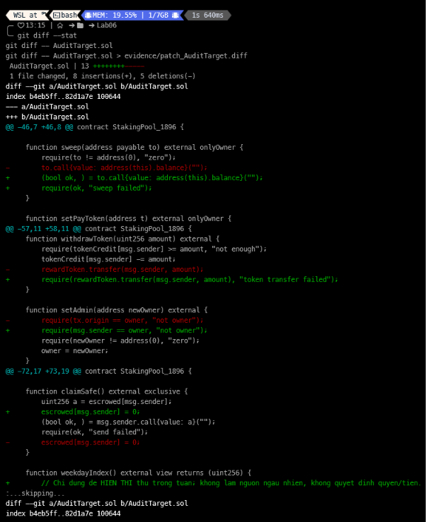
*Hình 8: git diff của AuditTarget.sol: kiểm tra kết quả call và transfer, msg.sender thay tx.origin trong setAdmin, CEI trong claimSafe, suppression weak-prng có lý do (8 dòng thêm, 5 dòng xóa).*

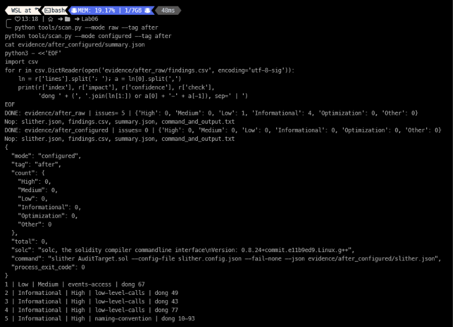
*Hình 9: Quét AFTER: after_configured còn 0 finding; after_raw còn 5 cảnh báo Low/Informational (events-access, low-level-calls ×3, naming-convention) đã được triage.*

## 3. Kiến trúc / Inheritance (1,5 điểm)

- Lệnh printer đã chạy: `python tools/print_arch.py`, script chạy `slither contracts/ArchitectureDemo.sol --print human-summary --config-file config/slither.raw.json --fail-none` và tương tự với `--print inheritance-graph`. Slither 0.11.6 ghi tệp `contracts/ArchitectureDemo.sol.inheritance-graph.dot` (dòng `Inheritance Graph:` trong `printer_log.txt`), trong khi script tìm tệp `ArchitectureDemo.sol.dot`, nên script dừng với mã 1 và thông báo `Khong tim thay *.dot`. Tệp DOT được chuyển vào `evidence/architecture/` và kết xuất thủ công: `dot -Tpng evidence/architecture/ArchitectureDemo.sol.inheritance-graph.dot -o evidence/architecture/inheritance.png`. Nội dung đồ thị không bị ảnh hưởng (Hình 10).
- Ảnh `evidence/architecture/inheritance.png` (bản gốc từ Graphviz) và `evidence/architecture/inheritance_annotated.png` (bản có chú thích, Hình 11); kèm `ArchitectureDemo.sol.inheritance-graph.dot`, `human_summary.txt`, `printer_log.txt`. Human summary ghi nhận **3 contract, 23 SLOC**, 0 dòng assembly, 1 vấn đề Optimization, 0 vấn đề Informational/Low/Medium/High; contract triển khai `StudentAsset` có 4 hàm, không thuộc chuẩn ERC nào, không bị đánh giá là mã phức tạp. Đồ thị có hai cạnh: `StudentAsset -> AccessManaged` (thứ tự 1) và `StudentAsset -> BalanceLedger` (thứ tự 2).
- Access control nằm ở **`AccessManaged`** (abstract; `admin` public được gán `msg.sender` trong constructor; modifier `onlyAdmin` kiểm tra `msg.sender == admin`); logic số dư nằm ở **`BalanceLedger`** (`mapping balances` internal, `balanceOf` external view, `_credit` internal cộng số dư không có kiểm tra); contract triển khai nằm ở **`StudentAsset is AccessManaged, BalanceLedger`** (entrypoint `mint(to, amount) external onlyAdmin` gọi `_credit` và phát event `Mint`).
- Giải thích 3–5 câu điểm audit cần bắt đầu: Audit nên bắt đầu từ contract được triển khai `StudentAsset`, cụ thể là `mint(address,uint256)`, entrypoint `external` duy nhất làm thay đổi state. Từ đây lần theo đồ thị kế thừa lên hai contract cha, vì logic security-critical không nằm ở `StudentAsset` mà ở `AccessManaged` (modifier `onlyAdmin` quyết định ai được tạo số dư) và `BalanceLedger` (`_credit` ghi trực tiếp vào `balances`, không giới hạn tổng cung). Do `_credit` không tự kiểm tra gì, toàn bộ an toàn của số dư phụ thuộc vào kiểm soát truy cập của hàm gọi nó: chỉ cần sai sót ở `onlyAdmin` hoặc một hàm mới gọi `_credit` mà thiếu modifier là phát hành số dư vô hạn. Ngoài ra `AccessManaged` không có hàm chuyển hoặc thu hồi `admin`, nên mất khóa admin đồng nghĩa mất vĩnh viễn khả năng quản trị; đây là điểm thiết kế cần ghi nhận.

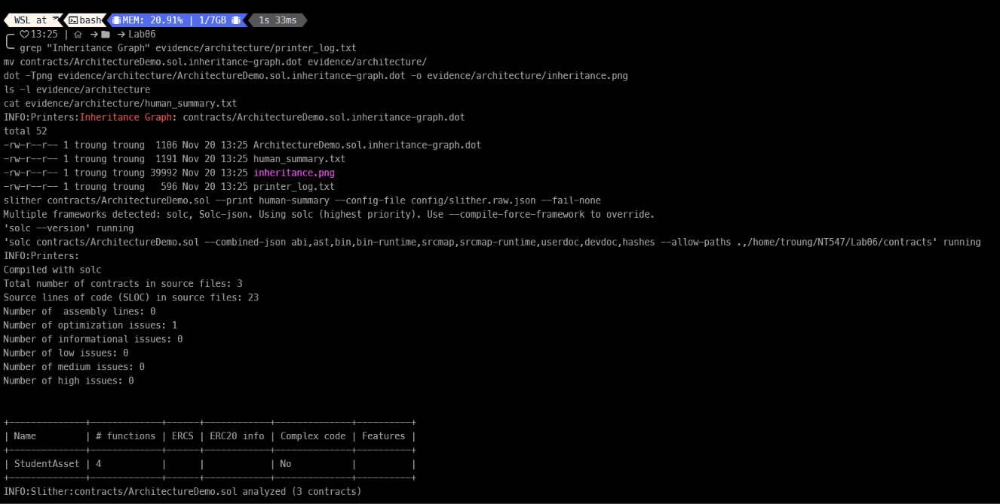
*Hình 10: Printer trên contracts/ArchitectureDemo.sol: printer_log.txt chỉ ra tệp ArchitectureDemo.sol.inheritance-graph.dot, tệp được chuyển vào evidence/architecture/ và kết xuất thành inheritance.png bằng Graphviz; human-summary ghi 3 contract, 23 SLOC.*

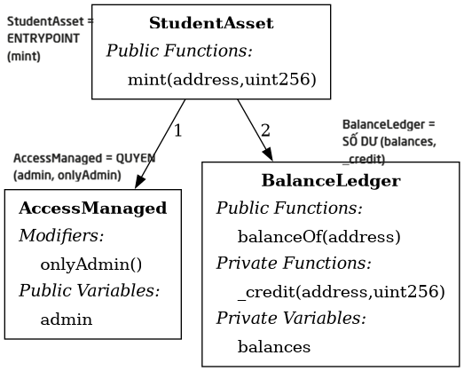
*Hình 11: Đồ thị kế thừa có chú thích: AccessManaged quản lý quyền (admin/onlyAdmin), BalanceLedger quản lý mapping số dư (_credit), StudentAsset là contract triển khai với entrypoint mint().*

## 4. Red -> Green CI (2,5 điểm)

Workflow `.github/workflows/slither.yml` (“Lab06 Slither gate”) chạy khi `push`, `pull_request` hoặc `workflow_dispatch`; job `audit` trên `ubuntu-latest`, quyền tối thiểu `contents: read`, gồm `actions/checkout@v6` và `crytic/slither-action@v0.4.2` với `target: AuditTarget.sol`, `solc-version: 0.8.24`, `slither-version: 0.11.6`, `slither-config: slither.config.json`, `fail-on: medium`.

| Phase | Commit (full/short SHA) | Run URL | Kết quả | Detector khiến RED / lý do GREEN |
|---|---|---|---|---|
| Baseline vulnerable | `21b382070ce6a49c54713ddc685441c641ba82e4` / `21b3820` | https://github.com/Master-Pillow/Lab6-Blockchain/actions/runs/44671673502 | RED | 6 finding ≥ Medium: `weak-prng`, `encode-packed-collision`, `reentrancy-eth`, `unchecked-transfer` (High); `tx-origin`, `unchecked-lowlevel` (Medium); log: `analyzed (2 contracts with 64 detectors), 6 result(s) found` |
| Patched | `6a72656d8bbb59e0f8c32b198e6caa95155ce703` / `6a72656` | https://github.com/Master-Pillow/Lab6-Blockchain/actions/runs/44687178372 | GREEN | 0 finding sau cấu hình (`0 result(s) found`); 5 cảnh báo Low/Info còn lại nằm dưới ngưỡng và đã được triage |

Tính hợp lệ của RED được xác nhận qua log (Hình 13, 14): checkout thành công, Slither biên dịch được hợp đồng bằng solc 0.8.24, job thất bại vì các khối `Detector: ...` kèm đường dẫn `Reference` tới tài liệu detector, không phải vì lỗi biên dịch, mạng hay xác thực. Run GREEN ở Hình 15, 16. Hành vi gate còn được kiểm chứng cục bộ bằng lệnh tương đương `slither AuditTarget.sol --config-file slither.config.json --fail-medium`: 6 result(s), mã thoát khác 0 với bản baseline; 0 result(s), mã thoát 0 với bản đã sửa, khớp với RED/GREEN trên GitHub.

- So sánh local `--fail-none` (thu thập findings) với CI `fail-on: medium`: hai cơ chế phục vụ hai mục đích khác nhau. `scan.py` dùng `--fail-none` để **thu thập bằng chứng**: mã thoát luôn bằng 0 dù có bao nhiêu finding, bảo đảm `slither.json`, CSV và summary luôn được ghi ra; vì vậy “exit 0” ở máy cục bộ không mang ý nghĩa an toàn. Ngược lại `fail-on: medium` trên CI là cơ chế **cưỡng chế** (enforcement), tương đương cờ `--fail-medium`: chỉ cần còn một finding Medium hoặc High sau khi áp cấu hình là step Slither thất bại, kết quả phân tích được chuyển thành trạng thái pass/fail của commit và chặn mã lỗi đi tiếp trong pipeline. “GREEN” trên CI chỉ có nghĩa là không còn finding vượt ngưỡng trong phạm vi detector đã cấu hình.
- `exclude_low/informational` thay đổi kết quả hiển thị ra sao: hai tùy chọn này giảm số detector được chạy từ 102 xuống 64 và ẩn khỏi kết quả 4 cảnh báo Informational ở bản baseline (10 -> 6), cùng 1 Low và 4 Informational ở bản đã sửa (5 -> 0). Chúng không làm thay đổi kết quả gate, vì `fail-on: medium` vốn bỏ qua Low/Informational, nhưng giúp log CI tập trung vào các vấn đề có thể chặn merge. Đổi lại, cấu hình lọc có thể che các tín hiệu hữu ích như `events-access`, nên bản quét raw vẫn được lưu song song làm bằng chứng đầy đủ. Bài làm không dùng `exclude_medium` hay `exclude_high`, vì làm vậy sẽ vô hiệu hóa chính gate.

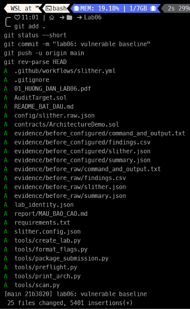
*Hình 12: Commit "lab06: vulnerable baseline" (21b3820) chứa AuditTarget.sol chưa sửa và evidence BEFORE, không có .venv.*

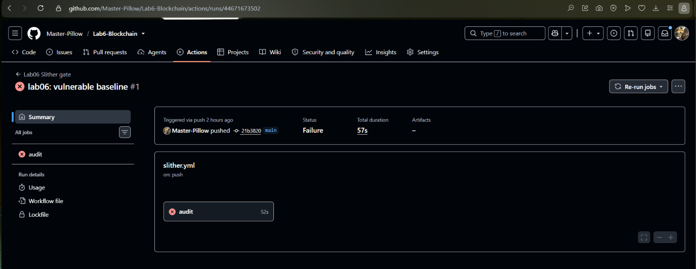
*Hình 13: Run 44671673502 của "Lab06 Slither gate" cho commit baseline 21b3820 kết thúc Failure (RED).*

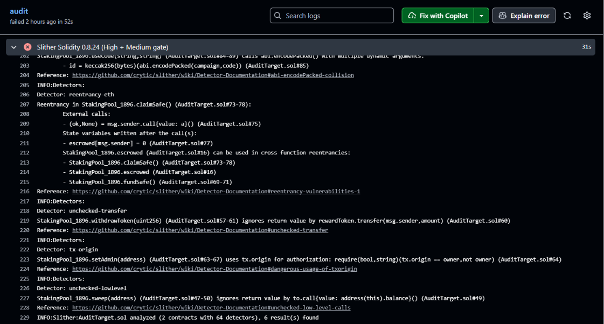
*Hình 14: Log step Slither của run baseline: 6 result(s) found với các detector reentrancy-eth, unchecked-transfer, tx-origin, unchecked-lowlevel (cùng encode-packed-collision, weak-prng phía trên), job thất bại do finding chứ không phải lỗi setup.*

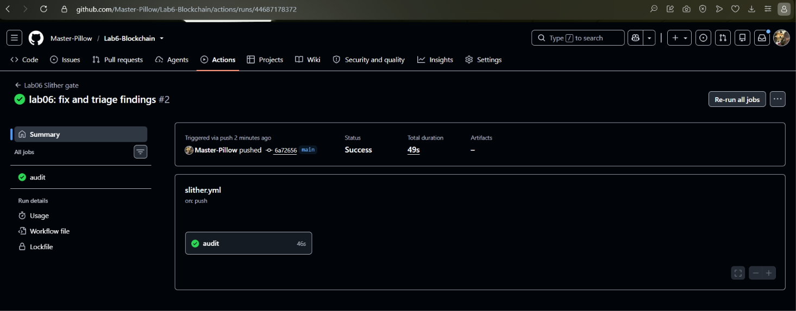
*Hình 15: Run 44687178372 cho commit patched 6a72656 đạt Success (GREEN) dưới ngưỡng fail-on: medium.*

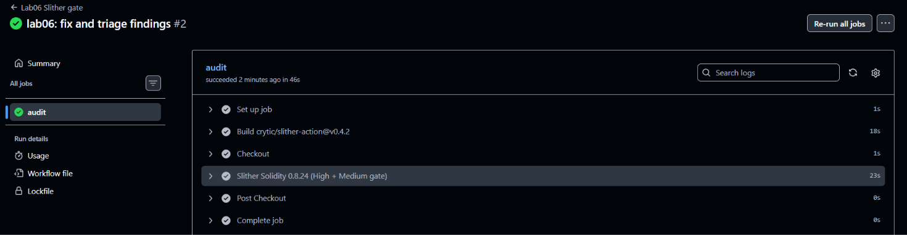
*Hình 16: Job audit của run patched: mọi step, gồm "Slither Solidity 0.8.24 (High + Medium gate)", đều thành công; GREEN chỉ chứng minh vượt gate đã cấu hình.*

## 5. Mutation RED -> GREEN (1,5 điểm)

- Mutation một dòng: `require(msg.sender == owner, "not owner")` -> `require(tx.origin == owner, "not owner")` trong `modifier onlyOwner` (M1, AuditTarget.sol:22, commit `89c952d`). `git diff --numstat` = `1 1 AuditTarget.sol`, commit chỉ chứa `AuditTarget.sol` (Hình 17).
- Detector kỳ vọng: `tx-origin` (mức Medium); xác nhận của em từ CI: **run của M1 kết thúc Success (GREEN), Slither không báo gì** (Hình 18). Chạy lệnh tương đương cục bộ `slither AuditTarget.sol --config-file slither.config.json --fail-medium` cho `0 result(s) found`, `exit=0` (Hình 19), tức mutant **sống sót** (false negative). Phân tích mã nguồn Slither 0.11.6 chỉ ra hai nguyên nhân:
  1. **Detector `tx-origin` không quét modifier.** Trong `slither/detectors/statements/tx_origin.py`, hàm `detect_tx_origin` (dòng 63–75) chỉ duyệt `for f in contract.functions` (dòng 65). Slither tách modifier vào tập `contract.modifiers` riêng, nên điều kiện `tx.origin` nằm trong modifier không bao giờ được kiểm tra. Cùng điều kiện đó trong thân hàm (`setAdmin` ở bản baseline) thì bị phát hiện bình thường.
  2. **Heuristic bảo vệ dựa trên tên modifier.** `Function.is_protected()` (`slither/core/declarations/function.py`, dòng 1544) coi mọi hàm có modifier tên `onlyOwner` là đã được bảo vệ mà không xét thân modifier; docstring của hàm cũng thừa nhận sẽ phân loại sai nếu `onlyOwner` cài đặt sai. Do đó các detector khác dựa trên `is_protected` (ví dụ gửi ETH tùy ý trong `sweep`) cũng im lặng.

  Hệ quả an ninh của M1 thực chất **nghiêm trọng hơn** bản baseline: cả `ownerWithdraw`, `sweep`, `setPayToken` đều khai thác được qua contract trung gian theo kịch bản ở mục 2, vậy mà gate vẫn GREEN. Để xác nhận gate vẫn bắt được lỗi `tx-origin` khi lỗi nằm trong phạm vi detector, sau khi revert M1 bằng commit mới, cùng phép đột biến được áp cho câu lệnh phân quyền trong thân hàm `setAdmin` (**M2**, dòng 65 của bản đã sửa; Hình 20). Log CI của M2 (Hình 21): `Detector: tx-origin` – `StakingPool_1896.setAdmin(address) (AuditTarget.sol#64-68) uses tx.origin for authorization: require(bool,string)(tx.origin == owner,not owner) (AuditTarget.sol#65)`, `Reference ...#dangerous-usage-of-txorigin`, `1 result(s) found`, job **RED**. Revert M2 đưa `main` về GREEN.

| Phase | Commit SHA | Run URL | Kết quả |
|---|---|---|---|
| Mutation M1 (`onlyOwner`, dòng 22 – theo đề) | `89c952d7d75c7d88db7862778289eab0a789579e` | https://github.com/Master-Pillow/Lab6-Blockchain/actions/runs/44689633339 | GREEN (mutant sống sót – false negative của detector) |
| Revert M1 | `54d372c3a865955a57770802803c4589b4a1be5f` | https://github.com/Master-Pillow/Lab6-Blockchain/actions/runs/44690167503 | GREEN |
| Mutation M2 (`setAdmin`, dòng 65) | `5a9a3f3a68017a8214ced1adfa73b2a38e9b04f5` | https://github.com/Master-Pillow/Lab6-Blockchain/actions/runs/44690417861 | RED (`tx-origin`) |
| Revert mutation M2 | `8c008e1428c390cb5c9981117b7ddd31a063dce9` | https://github.com/Master-Pillow/Lab6-Blockchain/actions/runs/44690714245 | GREEN |

Chuỗi RED -> GREEN -> RED -> GREEN được thể hiện bởi các phase Baseline, Patched, M2 và Revert M2; M1 được giữ lại làm bằng chứng về false negative. Cả hai mutation đều được hoàn tác bằng `git revert` (commit mới), không `reset --hard` hay `push --force` (Hình 22, 23).

- Giải thích sự thay đổi về nguồn định danh/authorization: `msg.sender` là địa chỉ gọi trực tiếp khung thực thi hiện tại (EOA hoặc contract), còn `tx.origin` là EOA đã ký giao dịch và giữ nguyên dọc toàn bộ chuỗi lời gọi. Phân quyền bằng `tx.origin` đồng nhất “ai khởi tạo giao dịch” với “ai đang yêu cầu thao tác”: bất kỳ contract trung gian nào mà owner tương tác đều kế thừa thẩm quyền của owner, dẫn tới tấn công kiểu confused deputy hoặc phishing. Ngoài ra, nếu owner là ví hợp đồng (multisig), `tx.origin` là EOA ký nên không bao giờ bằng `owner`. Sau EIP-7702 (nâng cấp Pectra), EOA còn có thể được ủy quyền thực thi mã, nên mọi giả định dựa trên `tx.origin` càng kém tin cậy. Phân quyền đúng phải dựa trên `msg.sender`.
- Bài học về thiết kế quality gate: gate dựa trên một công cụ phân tích tĩnh có điểm mù hệ thống. Cần bổ sung (i) detector Slither tùy biến hoặc luật Semgrep duyệt cả modifier; (ii) unit/fuzz test (ví dụ Foundry) khẳng định một contract trung gian không thể gọi các hàm `onlyOwner` khi owner là người khởi tạo giao dịch; (iii) mutation testing định kỳ để đo độ nhạy của pipeline.

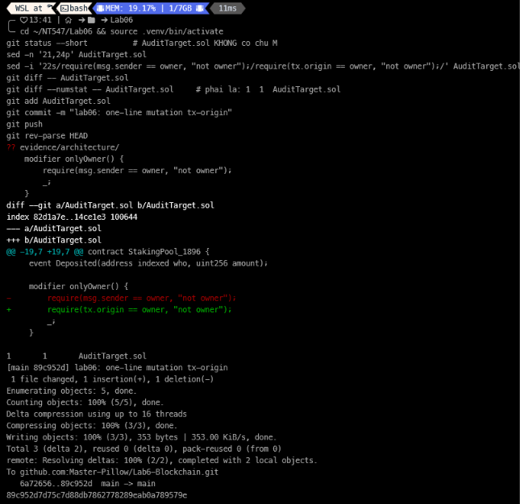
*Hình 17: Mutation M1 đúng một dòng tại dòng 22 trong modifier onlyOwner (msg.sender → tx.origin); git diff --numstat = 1/1, commit 89c952d chỉ chứa AuditTarget.sol.*

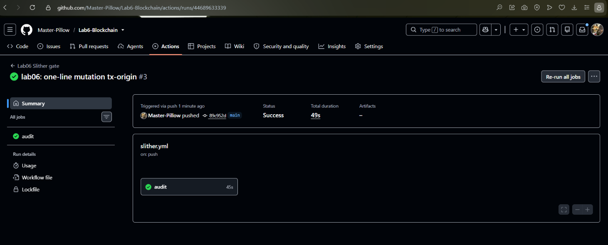
*Hình 18: Run 44689633339 của commit mutation M1 (89c952d): Success (GREEN); detector tx-origin không phát hiện điều kiện nằm trong modifier.*

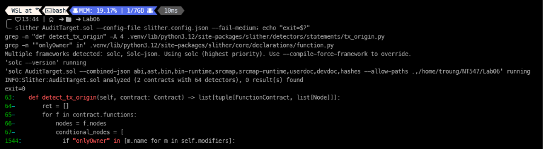
*Hình 19: Kiểm chứng cục bộ: Slither 0.11.6 cho 0 result(s), exit=0 với bản M1; detector tx-origin chỉ duyệt contract.functions và is_protected() tin vào tên modifier onlyOwner.*

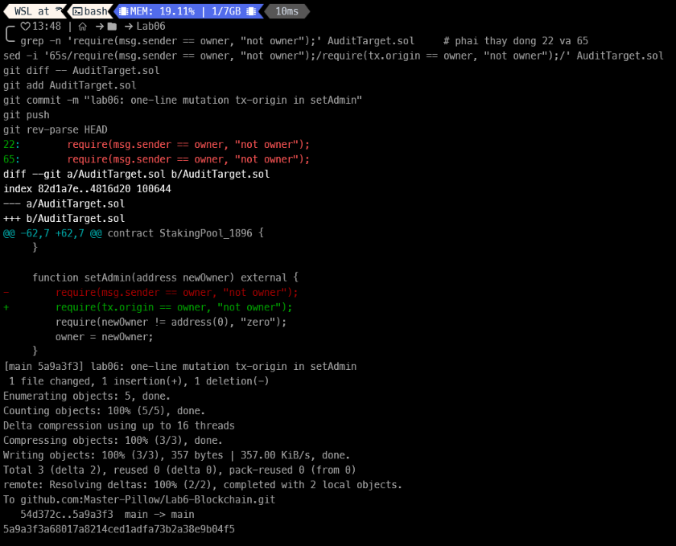
*Hình 20: Mutation M2 một dòng tại dòng 65 trong hàm setAdmin (msg.sender → tx.origin) sau khi đã revert M1; commit 5a9a3f3.*

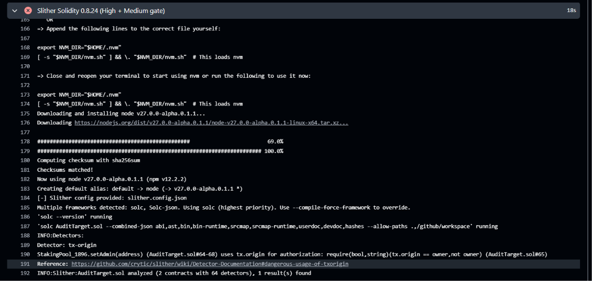
*Hình 21: Log run M2: detector tx-origin báo setAdmin dùng tx.origin để phân quyền tại AuditTarget.sol#65, 1 result(s) found, job kết thúc Failure (RED).*

## 6. Bằng chứng, tự kiểm

| Phase | Commit SHA (short) | Run | Trạng thái | Nguyên nhân |
|---|---|---|---|---|
| Baseline | `21b3820` | [44671673502](https://github.com/Master-Pillow/Lab6-Blockchain/actions/runs/44671673502) | RED | 4 High + 2 Medium |
| Patched | `6a72656` | [44687178372](https://github.com/Master-Pillow/Lab6-Blockchain/actions/runs/44687178372) | GREEN | Không còn finding ≥ Medium |
| Mutation M1 (`onlyOwner`) | `89c952d` | [44689633339](https://github.com/Master-Pillow/Lab6-Blockchain/actions/runs/44689633339) | GREEN | False negative: `tx-origin` không quét modifier |
| Revert M1 | `54d372c` | [44690167503](https://github.com/Master-Pillow/Lab6-Blockchain/actions/runs/44690167503) | GREEN | Mutation M1 đã revert |
| Mutation M2 (`setAdmin`) | `5a9a3f3` | [44690417861](https://github.com/Master-Pillow/Lab6-Blockchain/actions/runs/44690417861) | RED | `tx-origin` tại AuditTarget.sol#65 |
| Revert M2 | `8c008e1` | [44690714245](https://github.com/Master-Pillow/Lab6-Blockchain/actions/runs/44690714245) | GREEN | Mutation M2 đã revert |

Commit “lab06: report and evidence” (báo cáo + `evidence/architecture/`) tạo thêm một run chỉ cập nhật báo cáo/evidence, không thuộc các phase trên.

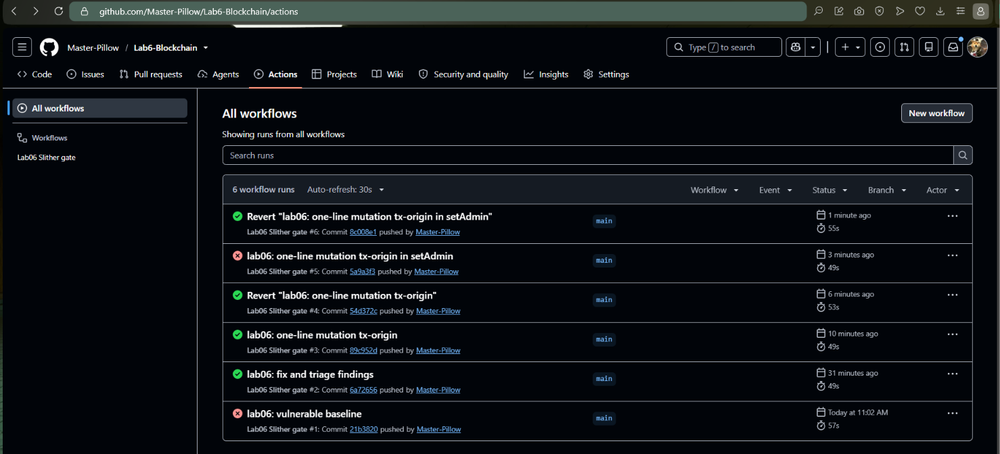
*Hình 22: Danh sách run của "Lab06 Slither gate": Baseline RED → Patched GREEN → M1 GREEN → Revert M1 GREEN → M2 RED → Revert M2 GREEN.*

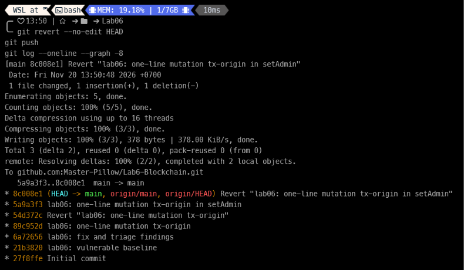
*Hình 23: Lịch sử Git của nhánh main: các commit baseline, fix, mutation và revert, không reset hay force-push.*

- [x] `AuditTarget.sol`, `lab_identity.json`
- [x] `evidence/before_raw/` và `evidence/before_configured/`
- [x] `evidence/after_raw/` và `evidence/after_configured/`
- [x] `evidence/architecture/`
- [x] 04 URL Actions run RED/GREEN/RED/GREEN + 04 commit SHA (Baseline, Patched, M2, Revert M2; kèm M1 và Revert M1)
- [x] Link repo và ảnh màn hình có terminal / URL / commit SHA; không cắt mất ngữ cảnh
- [x] Các finding được triage, không chép lại mô tả detector thay cho suy luận
- [x] Tuyệt đối không có seed phrase, private key, credentials

**Nhận xét cuối cùng (5–7 câu):** Bài thực hành đã xây dựng trọn vẹn một quy trình security automation cho hợp đồng `StakingPool_1896`: quét tĩnh bằng Slither ở hai chế độ (raw 10 finding, configured 6 finding, cùng 4 High và 2 Medium), triage theo ngữ cảnh, khắc phục, quét lại và đưa kết quả vào quality gate trên GitHub Actions. Trong sáu finding High/Medium, bốn là lỗi thật (`tx.origin`, unchecked low-level call, unchecked ERC20 transfer, va chạm `encodePacked`) đã được sửa tận gốc; hai là cảnh báo theo ngữ cảnh: reentrancy được xử lý phòng thủ bằng CEI, còn `weak-prng` được chấp nhận bằng suppression đúng detector, đúng dòng, có lý do. Kết quả cho thấy impact do công cụ gán không đồng nhất với rủi ro thực tế: một finding High có thể vô hại, trong khi một lỗi Medium như `tx.origin` lại dẫn tới mất toàn bộ tài sản. Pipeline chuyển từ RED sang GREEN, xác nhận gate `fail-on: medium` hoạt động đúng với các mẫu lỗi nằm trong phạm vi detector. Đáng chú ý nhất, mutation theo đề trong modifier `onlyOwner` không bị phát hiện vì detector `tx-origin` của Slither 0.11.6 không quét modifier; đây là một false negative có căn cứ mã nguồn, và phải dùng mutation M2 trong thân hàm mới có RED. Vì vậy GREEN chỉ chứng minh hợp đồng vượt qua tập luật đã cấu hình chứ không chứng minh an toàn, nên phân tích tĩnh cần được kết hợp với review thủ công, kiểm thử và mutation testing định kỳ.
